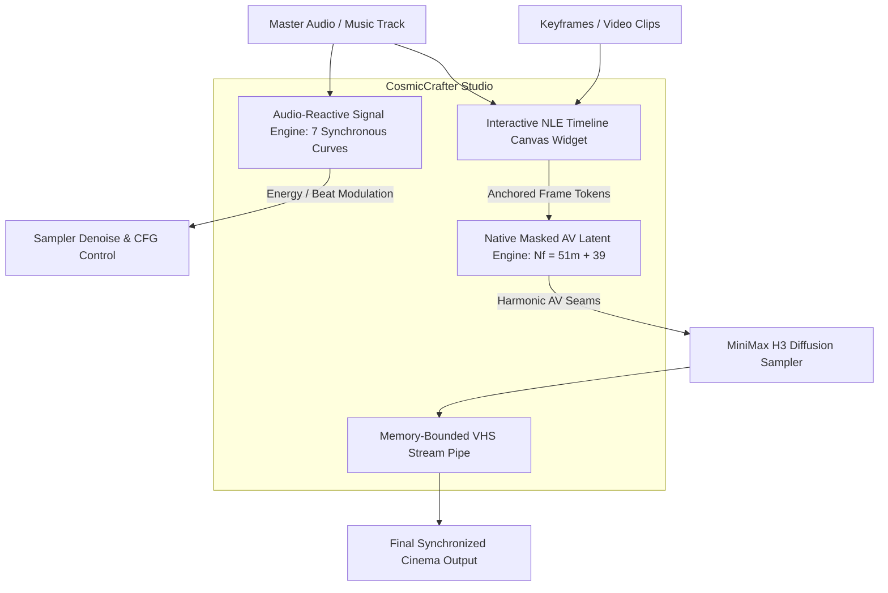

# CosmicCrafter H3 Studio 🎬✨🎵

**The Unified Visual Timeline & Audio-Reactive Audiovisual Studio for MiniMax H3 in ComfyUI.**

---

## 🌟 What is CosmicCrafter H3 Studio?

**CosmicCrafter H3 Studio** is a comprehensive, production-grade creative suite for MiniMax H3 video synthesis. It solves the sprawling "canvas maze" problem by combining an **all-in-one interactive NLE timeline canvas widget** with a **zero-dependency pure-PyTorch audio-reactive engine** and **sample-accurate latent masking with memory-bounded VHS streaming**.



---

## 🚀 Key Features

### 1. 🎞️ Interactive NLE Visual Timeline Studio (`CosmicCrafterTimeline`)
* **HTML5 Canvas Timeline**: A full 840px wide timeline widget embedded directly inside the node.
* **Multi-Track Support**:
  * **Video Lane**: Drag-and-drop still images, keyframe anchors, and full video clips.
  * **Audio Lane**: Real-time waveform visualization with scrubbable playhead.
  * **Automation Curves**: Green control envelopes for modulating influence, CFG, and denoise over time.
* **Professional Editing Tools**: Per-clip trimming handles, magnetic snapping, multi-selection group dragging, zoom slider, dedicated Undo/Redo, and playable preview.

### 2. 🎧 Zero-Dependency Audio-Reactive Engine (`CosmicCrafterAudioAnalyze`)
Pure PyTorch STFT/FFT signal processor running synchronously at native 24 fps:
* **`energy`**: Root-Mean-Square (RMS) loudness envelope for continuous kinetic driving.
* **`beats`**: Percussion kick and transient tracker with exponential decay envelopes ($e^{-\lambda t}$).
* **`brightness`**: Spectral centroid tracking timbre brightness and acoustic tension.
* **`onsets`**: Half-wave rectified spectral flux detecting musical note attacks.
* **`bass` (20–250 Hz)**: Sub-bass and kick resonance curve.
* **`mids` (250–4000 Hz)**: Vocal, snare, and melodic energy curve.
* **`highs` (4000–16000 Hz)**: Cymbals, hi-hats, and air sparkle curve.

### 3. 🎛️ Audio Modulation Suite
* **`CosmicCrafterAudioReactiveDenoise`**: Automatically map musical energy to diffusion sampler denoise values (e.g. subtle motion during quiet verses, explosive transformation on beat drops).
* **`CosmicCrafterAudioCurveRemap`**: Power-law gamma shaping ($y = x^\gamma$), 1D uniform boxcar moving average smoothing, and noise threshold gating.

### 3b. 🥁 Beat-Accurate Latent Masking (no external packs required)

Three nodes take an audio curve all the way to the sampler, replacing the
`FeatureToMask` / `MaskComposite` / `SetLatentNoiseMask` chain that earlier
drafts borrowed from other packs:

* **`CosmicCrafterAudioCurveToMask`**: renders a per-frame curve into an animated `MASK`. Spatial modes: `uniform`, `radial`, `vignette`, `vertical_bars`, `horizontal_sweep`, plus gamma / gate / floor / ceiling shaping.
* **`CosmicCrafterMaskComposite`**: composites a subject mask against the pulse (`multiply`, `screen`, `maximum`, …) with automatic frame and resolution matching. A 1-frame subject cutout is **repeated**, never interpolated, so a still subject stays locked.
* **`CosmicCrafterLatentNoiseMask`**: writes the result onto an H3 AV latent as a correctly-nested noise mask, with independent control of the audio stream (`denoise` / `preserve` / `follow_curve`).
* **`CosmicCrafterSourceToLatent`**: VAE-encodes the source still (or clip) into the latent's video stream, so the masked region actually contains the subject rather than empty latent space.

#### Why the dedicated latent-mask node exists

Stock `SetLatentNoiseMask` stores a bare `[N,1,H,W]` tensor. H3's latent is a
*nested* pair — video `[B,24,T,H/16,W/16]` and audio `[B,32,2,T40]` — so the
sampler substitutes an all-ones mask for the audio stream and **trilinearly
interpolates** the video mask down to `T`.

Interpolation is point-sampling, and H3 packs ~3.4 source frames into one latent
frame (exactly `1,4,4,4,4` frames per 5-token group). A one-frame beat hit lands
between samples and averages away — precisely the percussive detail that makes a
mask read as audio-reactive.

`CosmicCrafterLatentNoiseMask` instead **aggregates**: each latent frame takes
the max (or mean/min) over every source frame that VAE-encodes into it, and the
masks are emitted at the latent's exact shape so the sampler's own
`reshape_mask` becomes a no-op.

It also snaps the mask to H3's **2×2 token grid**. `comfy/ldm/minimax/model.py`
patchifies the video latent at `(1, 2, 2)`, so one token spans a 2×2 block of
latent pixels and is denoised as a unit — a mask that varies inside a block is
asking for something the model cannot express, and the edge fringes. `max`
snapping (the default) resolves a straddling block toward *denoise*; pick `min`
when the subject boundary matters more than the background reaching it.

Measured on a 124-frame clip carrying 11 single-frame beats (37 latent frames):

| Approach | Beats surviving at full amplitude | Peak |
| --- | --- | --- |
| Stock `SetLatentNoiseMask` (trilinear) | **1 / 11** (8 erased to 0.00) | 0.905 |
| `CosmicCrafterLatentNoiseMask` (aggregate) | **11 / 11** | 1.000 |

### 4. 🔒 Harmonic Latent-Masking Engine ($M_{\text{audio}} = 0$)
* **Exact Musical Timing**: Locks the master audio track with zero re-encoding loss.
* **Harmonic Boundary Quantization**: Enforces strict mathematical resonance between 24 fps video and 40 Hz audio latents:
  $$N_f = 51m + 39 \quad (m \in \mathbb{N}_0 \implies 39, 90, 141, 192, 243\dots \text{ frames})$$
* **Acoustic Seam Feathering**: 8-tick ($0.2\text{ s}$) half-cosine windowing across clip boundaries.
* **Sub-Sample Timebase Conformance**: Automated resampling with factor $\gamma = \frac{N_{\text{target}}}{N_{\text{decoded}}}$.

### 5. 🌊 Memory-Bounded VHS Streaming Output
* Eliminates out-of-memory (OOM) crashes by streaming decoded clips directly into `VHS_VideoCombine` one chunk at a time.
* Linear pixel ramp blending across overlapping clip seams ($N_{\text{overlap}} = 39$).

---

## 📦 Bundled Workflows

All example workflows are located in the `example_workflows/` folder:

1. **`UTILITY - H3 Timeline Canvas.json`**: Single-node visual NLE timeline editor setup.
2. **`UTILITY - Audio Reactive.json`**: Complete music-reactive video synthesis pipeline.
3. **`NEW - Music Video.json`**: Full 20-clip long-form music video production chain.
4. **`NEW - AV Extension.json`**: 6-extension continuation chain with seamless audio-visual stitching.
5. **`UTILITY - Custom Keyframes.json`**: Compact keyframe anchor workflow.

Three graphs ship in `workflows/`, in two families.

### How much does H3 do on its own? Most of it.

H3 is a **single-stream packed-token DiT**. Its sequence is
`[text | cond | audio | video]`, assembled into one tensor and run through shared
self-attention — so **video tokens attend to audio tokens at every layer**
(`comfy/ldm/minimax/model.py`). The model was trained on AV pairs and
synchronises motion to music *itself*.

Feed the real song into the AV latent's audio stream and protect it — which
`MiniMaxH3SongMaskedAVContext` does — and you get audio-reactive video with **no
masking at all**. That is the native path, and it renders an actual video.

Latent masking is a different thing: a *compositing* effect. It pins part of the
frame, which necessarily **suppresses** the model's own motion wherever the mask
holds. Use it when a locked subject is the point, not as the way to get
reactivity.

### The graphs

* **`CosmicCrafter_AudioReactive_MusicVideo_Native.json`** — full-frame, no
  masking. The song drives the model directly; energy modulates sampler denoise.
  17 nodes. **Start here to make a video.**
* **`CosmicCrafter_AudioReactive_SubjectLock.json`** — adds core SAM 3
  (`SAM3_Detect`, text-prompted) plus the latent mask, so a named subject holds
  still while the background reacts.
* **`CosmicCrafter_AudioReactive_SubjectLock_RMBG.json`** — same, with RMBG
  matting instead of SAM 3. No prompt, no 1.7 GB SAM checkpoint.

```
                       ┌─ native: sampler denoises this directly ──────────┐
LoadAudio ─→ SongMaskedAVContext ──────────────────────────────────────────┤
       └──→ AudioAnalyze ─→ ReactiveDenoise ─→ BasicScheduler              │
                        └─→ CurveToMask ─┐                                 │
LoadImage ─→ SAM3_Detect / RMBG ─────────┴→ MaskComposite ─┐               │
        └──→ SourceToLatent ─────────────────────→ LatentNoiseMask ────────┴→ Sampler
                                    UNETLoader ─→ DifferentialDiffusion ─→ BasicGuider
             └──────────── subject-lock only ────────────┘
```

**Prompting the native graph.** The model already has the audio — don't describe
the music. Describe *how the picture should answer it*: camera movement against
the rhythm, what flares on the hits, how the performer carries the beat. The
shipped prompt is written that way.

**`SourceToLatent` is not optional.** `MiniMaxH3ImageToVideo` returns an
*empty* AV latent — the still it takes is attached as keyframe conditioning,
not as latent content. A denoise mask can only *preserve* what the latent
already holds, so masking that empty latent locks in blank latent space and the
"protected" subject decodes to flat grey. Encoding the source into the video
stream first is what gives the mask something real to protect.

**Differential Diffusion** is what makes the *graded* part of the mask
meaningful. Without it the sampler blends latents by mask value on every step,
which turns partial values to mush; with it each region begins denoising when
the schedule reaches its value. So the pulse's floor (`0.15`) becomes "drifts
only near the end" and its peak (`1.0`) becomes "fully regenerated" — audio
intensity maps to *amount of change*, not to a blend ratio.

Regenerate both with `python tools/build_audio_reactive_workflow.py`. Earlier
drafts are kept, with a written post-mortem, in `workflows/superseded/`.

---

## 🛠️ Installation

1. Copy or clone this folder into your ComfyUI `custom_nodes` directory:
   ```bash
   cd ComfyUI/custom_nodes
   git clone https://github.com/YourRepo/CosmicCrafter-H3-Studio.git
   ```
   To develop the pack outside `custom_nodes`, link it instead (Windows,
   no admin required):
   ```powershell
   New-Item -ItemType Junction -Path "<ComfyUI>\custom_nodes\CosmicCrafter-H3-Studio" -Target "<dev folder>"
   ```
2. Restart ComfyUI.
3. Find your nodes under the category `conditioning/minimax`.

Optional, for the bundled subject-lock workflow: `comfyui-sam3` (SAM 3 text
segmentation) and `comfyui-videohelpersuite` (video muxing). The audio-reactive
nodes themselves have **no dependencies beyond torch** — `librosa` is used for
beat tracking when present and falls back to a pure-PyTorch energy-peak
detector when it is not.

---

## 🧪 Testing & Verification

CosmicCrafter H3 Studio includes a comprehensive test suite covering mathematical timing, signal processing, and node contracts:
```bash
python tests/run_tests.py
# Result: 263 repo CPU/static checks passing (100% success)
```

---

## 📜 License

Licensed under GPL-3.0. Built on the open research of MiniMax H3 motion context engines.
