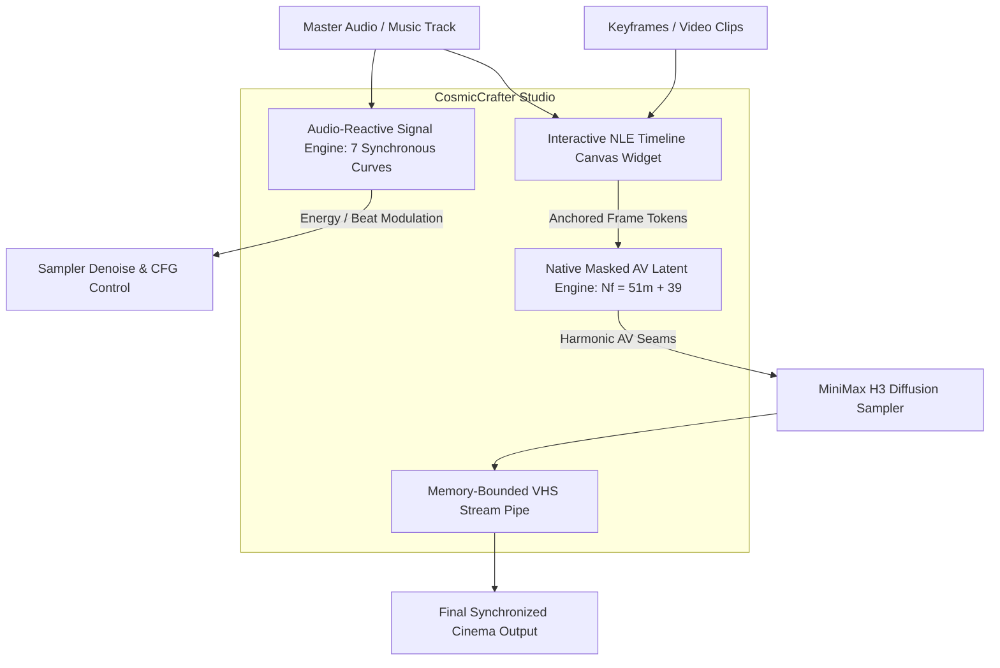

# CosmicCrafter H3 Studio 🎬✨🎵

**The Unified Visual Timeline & Audio-Reactive Audiovisual Studio for MiniMax H3 in ComfyUI.**

---

## 🌟 What is CosmicCrafter H3 Studio?

**CosmicCrafter H3 Studio** is a comprehensive, production-grade creative suite for MiniMax H3 video synthesis. It solves the sprawling "canvas maze" problem by combining an **all-in-one interactive NLE timeline canvas widget** with a **zero-dependency pure-PyTorch audio-reactive engine** and **sample-accurate latent masking with memory-bounded VHS streaming**.



---

## 🚀 Key Features

### 1. 🎞️ Interactive NLE Visual Timeline Studio (`CosmicCrafterTimeline`)
* **HTML5 Canvas Timeline**: A full 840px wide timeline widget embedded directly inside the node.
* **Multi-Track Support**:
  * **Video Lane**: Drag-and-drop still images, keyframe anchors, and full video clips.
  * **Audio Lane**: Real-time waveform visualization with scrubbable playhead.
  * **Automation Curves**: Green control envelopes for modulating influence, CFG, and denoise over time.
* **Professional Editing Tools**: Per-clip trimming handles, magnetic snapping, multi-selection group dragging, zoom slider, dedicated Undo/Redo, and playable preview.

### 2. 🎧 Zero-Dependency Audio-Reactive Engine (`CosmicCrafterAudioAnalyze`)
Pure PyTorch STFT/FFT signal processor running synchronously at native 24 fps:
* **`energy`**: Root-Mean-Square (RMS) loudness envelope for continuous kinetic driving.
* **`beats`**: Percussion kick and transient tracker with exponential decay envelopes ($e^{-\lambda t}$).
* **`brightness`**: Spectral centroid tracking timbre brightness and acoustic tension.
* **`onsets`**: Half-wave rectified spectral flux detecting musical note attacks.
* **`bass` (20–250 Hz)**: Sub-bass and kick resonance curve.
* **`mids` (250–4000 Hz)**: Vocal, snare, and melodic energy curve.
* **`highs` (4000–16000 Hz)**: Cymbals, hi-hats, and air sparkle curve.

### 3. 🎛️ Audio Modulation Suite
* **`CosmicCrafterAudioReactiveDenoise`**: Automatically map musical energy to diffusion sampler denoise values (e.g. subtle motion during quiet verses, explosive transformation on beat drops).
* **`CosmicCrafterAudioCurveRemap`**: Power-law gamma shaping ($y = x^\gamma$), 1D uniform boxcar moving average smoothing, and noise threshold gating.

### 4. 🔒 Harmonic Latent-Masking Engine ($M_{\text{audio}} = 0$)
* **Exact Musical Timing**: Locks the master audio track with zero re-encoding loss.
* **Harmonic Boundary Quantization**: Enforces strict mathematical resonance between 24 fps video and 40 Hz audio latents:
  $$N_f = 51m + 39 \quad (m \in \mathbb{N}_0 \implies 39, 90, 141, 192, 243\dots \text{ frames})$$
* **Acoustic Seam Feathering**: 8-tick ($0.2\text{ s}$) half-cosine windowing across clip boundaries.
* **Sub-Sample Timebase Conformance**: Automated resampling with factor $\gamma = \frac{N_{\text{target}}}{N_{\text{decoded}}}$.

### 5. 🌊 Memory-Bounded VHS Streaming Output
* Eliminates out-of-memory (OOM) crashes by streaming decoded clips directly into `VHS_VideoCombine` one chunk at a time.
* Linear pixel ramp blending across overlapping clip seams ($N_{\text{overlap}} = 39$).

---

## 📦 Bundled Workflows

All example workflows are located in the `example_workflows/` folder:

1. **`UTILITY - H3 Timeline Canvas.json`**: Single-node visual NLE timeline editor setup.
2. **`UTILITY - Audio Reactive.json`**: Complete music-reactive video synthesis pipeline.
3. **`NEW - Music Video.json`**: Full 20-clip long-form music video production chain.
4. **`NEW - AV Extension.json`**: 6-extension continuation chain with seamless audio-visual stitching.
5. **`UTILITY - Custom Keyframes.json`**: Compact keyframe anchor workflow.

---

## 🛠️ Installation

1. Copy or clone this folder into your ComfyUI `custom_nodes` directory:
   ```bash
   cd ComfyUI/custom_nodes
   git clone https://github.com/YourRepo/CosmicCrafter-H3-Studio.git
   ```
2. Restart ComfyUI.
3. Find your nodes under the category `conditioning/minimax`.

---

## 🧪 Testing & Verification

CosmicCrafter H3 Studio includes a comprehensive test suite covering mathematical timing, signal processing, and node contracts:
```bash
python tests/run_tests.py
# Result: 142 repo CPU/static checks passing (100% success)
```

---

## 📜 License

Licensed under GPL-3.0. Built on the open research of MiniMax H3 motion context engines.
