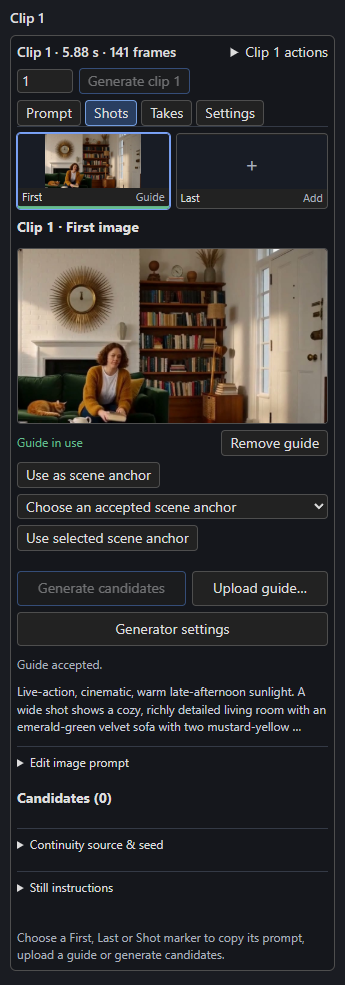
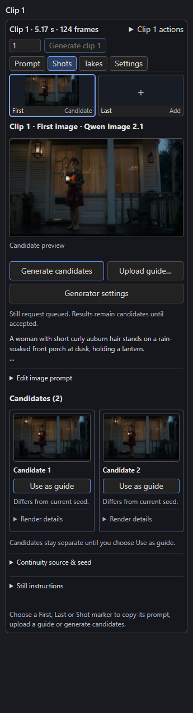
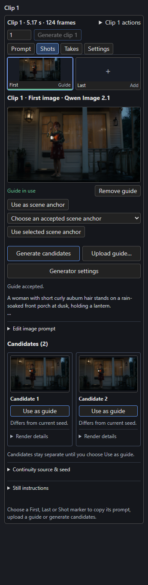

# First and last frames

A **guide** is a still image that pins part of a clip: its **First** frame, its **Last** frame, or a timed **Shot**. You can use a picture you already have, upload one, or generate candidates with a still generator and accept the one you like.

## Choose a picture you already have

In a clip's **Settings** tab, **First & last frame** lists every picture. Click one under **First frame** or **Last frame**, or choose **None**. **Upload…** adds a new picture and uses it in one step. See [References and pictures](references.md#pictures-saved-in-the-timeline).

## The Shots tab and the markers

Above the Timeline, every clip has a **First** and a **Last** marker, and a clip with several shots has one per shot. Click a marker (or press **Enter** or **Space** on it) to open its panel in the clip's **Shots** tab.

[{ align=right width=300 }](../assets/screens/frame-guide.png)

The panel offers:

| Control | Does |
| --- | --- |
| **Upload guide…** | Accepts a local image as this marker's guide. |
| **Generate candidates** | Asks the connected still generator for images (see below). Candidates stay candidates until you accept one. |
| **Generator settings** | Selects and centres the connected generator's node group in the graph so you can edit models, steps or sampler. |
| **Frame image prompt** | Enter a separate prompt for this First, Last or Shot target. Leave it blank to use the clip's current video prompt. |
| **Image seed** | Leave it empty to give every candidate a new random seed. Enter a number to repeat one exact seed; each candidate records the seed it used. |
| **Candidates (N)** | Each candidate keeps its prompt, exact seed and source. **Use as guide** assigns it; click a thumbnail for a large preview (**Esc** closes). |
| **Remove guide** | Removes the assignment. The image stays in your candidates. |

After you accept a guide the panel reads **Guide in use**, and the marker above shows its thumbnail. A guide never changes a render until you accept it.

You can also drop an image file onto a First, Last or Shot marker (above the Timeline or in the **Shots** tab), onto the panel's image area, or onto **First frame** or **Last frame** in the **Settings** tab. The dropped image becomes that marker's guide, the same as **Upload guide…**.

### Generating candidates

[{ align=left width=300 }](../assets/screens/still-candidates.png)
[{ align=right width=300 }](../assets/screens/still-guide-in-use.png)

The screenshots show two candidates the Qwen Image 2.1 example generated for a clip's First frame (about 40 s each on one RTX 5090 Laptop GPU), then the panel after **Use as guide** on one of them. The marker above the panel and the Timeline's **1 · First** marker now show the picture. The other candidate stays in the list until you remove it.

Still generation needs an image generator connected to the Timeline. The simplest connection is your own image workflow: wrap it in a native subgraph and connect its `IMAGE` output to the Timeline's `still_image` input; see [Stills with your own image workflow](own-image-workflow-stills.md). The example workflows below connect theirs through a **Still Recipe** or a ready-made node on the `still_recipe` input, which keeps working:

| Example workflow | Image generator |
| --- | --- |
| `examples/h3_timeline_fizgig_still.json` and `examples/h3_fizgig_still.json` | H3 with the Fizgig still recipe (stock Ref2VA weights, 3872 × 2176, `er_sde`, 50 steps). |
| `examples/qwen_story_studio.json` | Qwen Image 2.1, the default base generator. |
| `examples/qwen_story_studio_turbo.json` | Qwen Image 2.1 Turbo, the faster alternative. |
| `examples/h3_story_studio_qwen_references.json` | H3 video with Qwen images attached. |
| `examples/ph3_image_story_studio.json` | P-H3-Image, with one ready-made node and no recipe to build. See [Stills with P-H3-Image](p-h3-image-stills.md). |
| `examples/minimax_h3_image_story_studio.json` | Official MiniMax H3 Image, with one ready-made node. See [Stills with MiniMax H3 Image](minimax-h3-image-stills.md). |

Select models you have installed; nothing is downloaded. Other image generators connect through `still_image` with no extra node. The **Still Recipe** node's `bindings` input, which declares where a generator's prompt, seed, size and reference inputs are, remains for workflows that already use it; see the Qwen Story Studio notes in the repository for the schema.

!!! info "Which prompt is used"
    Generate candidates uses the **Frame image prompt** shown in the target panel. If it is blank, generation uses the selected clip's video prompt. Editing the frame field saves to that target and leaves the video prompt intact. **MiniMax H3 Image Still** sends that text as written unless its optional prompt enhancer is turned on, and splits a location sheet into separate views; see [Stills with MiniMax H3 Image](minimax-h3-image-stills.md#location-sheets). References remain image inputs; their labels and descriptions remain in candidate metadata. The subgraph's own prompt and instruction are used when you run it standalone.

### Continuity between stills

- Still requests use relevant Cast pictures and references named in the frame image prompt. With the video prompt fallback, reference selection follows the selected shot. Mention a picture wired directly to the still generator by its `@stillN` alias to include it.
- **Use as scene anchor** promotes the current accepted image; **Choose an accepted scene anchor** then **Use selected scene anchor** reuses an anchor from another scene when you return to a place.
- A camera cut keeps the anchor; a new scene starts another one. Changing an anchor marks dependent candidates as out of date.
- Without a chosen video take, accept First first, then Shot and Last in order: each new candidate receives the preceding accepted guide.
- Continuity needs no extra models, but it cannot guarantee that the generator obeys it. Inspect every candidate.

### Prepare all still prompts

A prepared still prompt fills the frame field when the target has no saved edit. You can edit it for that target or clear it to use the video prompt. Generation never calls the converter.

## How guides meet neighbouring clips

- On an unrendered **Continue** join, accepting clip B's First image assigns the same image to clip A's Last and clip B's First.
- If either neighbour has rendered material, accepting a replacement at B's First sets B to **Cut** and leaves A alone.
- When a verified saved predecessor ending exists, the First panel offers **Use saved predecessor ending**, which reuses that exact ending and restores **Continue**.
- Last targets the last *delivered* frame, including [exact-length](exact-lengths.md) trimming. Guides can use individual frames, not just the 17-frame grid.

## Guides inside a shot

A guide steers a frame within the same clip. It does not split the clip or rewrite its prompt. Interior guides remain usable even without a `[Shot N]` boundary, including guides in older saved projects.

### A guide at any frame

A Shot marker sits at the time its `[Shot N]` line gives (`At 0:02.500, …`). To guide a frame without adding a shot, open the clip's **Shots** tab and use the list under the markers:

- **Guide another frame**: enter the **Frame** (0 is the clip's first frame), then press **Upload guide…** or drop an image on the box. The guide is then listed as **Frame guide** with its frame.
- To move a guide, change its **Frame**. Moving a Shot marker's guide takes it off the marker; the marker keeps its candidates.
- A guide from an older project that kept its frame when its shot was removed is listed as a **Frame guide** too.
- A guide whose Shot marker was removed reads **Removed Shot N** with **Unused** under it and does not affect renders. Give it a frame to use it again.

Each frame can hold one guide.

Keep a continuous camera move, such as a tilt from someone's feet to the ceiling, in one clip with its guides. To separate planned shots, use **Split before Shot N** in the **Shots** tab at a timed shot boundary. Each half gets its own shots and the second clip starts as a **Cut**. See [Timeline editing](timeline.md).

Projects saved with earlier guide splits keep their boxes, prompts, guides and joins.

## Optional reusable images for Cast

The **Prepare references** section on the [Cast page](../story/cast.md) creates reviewable candidates for characters, scheduled appearances, locations and props before you generate First, Last or Shot images. The three generation switches start off and are independent.

- **Characters and looks** become a landscape character sheet on a plain ivory background with six columns. The face appears once, as a head-only close-up in the first two columns; the other four columns are neck-down body views (front, profile, back and relaxed) so no second face competes with it.
- **Locations** become one image split into 2 rows and 2 columns, showing the same empty place from four camera positions. If the place has an interior, such as a food stall booth, one of the four is a view from the inside. No people or animals are drawn in.
- **Props** become one image split into 2 rows and 2 columns on a plain ivory background, showing only the object from four angles (front, side, back and three-quarter).
- The Story style goes along, minus sentences that name another character. Location sheets also leave out style sentences about characters or people, so a line such as "orange belongs only to her jacket" no longer paints that character into every picture.

!!! warning "Experimental geometry"
    Reference delivery does not establish exact reconstructed geometry. The Qwen presets only partly followed a requested 45° camera change in testing, so treat arbitrary-view geometry as experimental and accept only candidates you have inspected.
