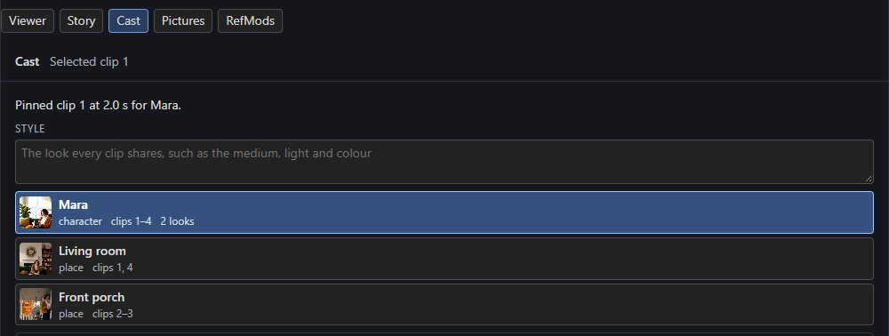
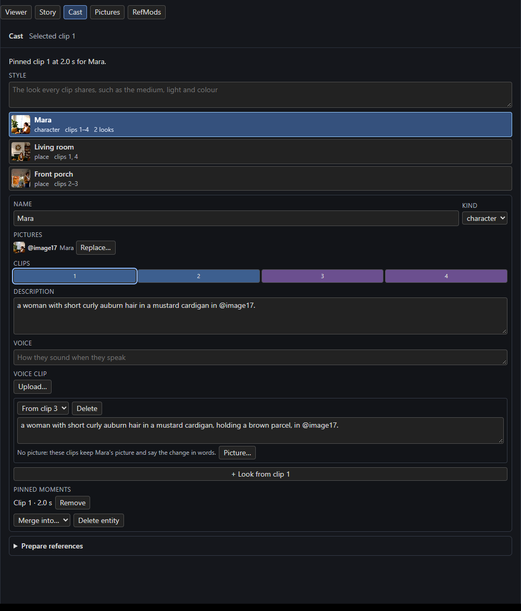
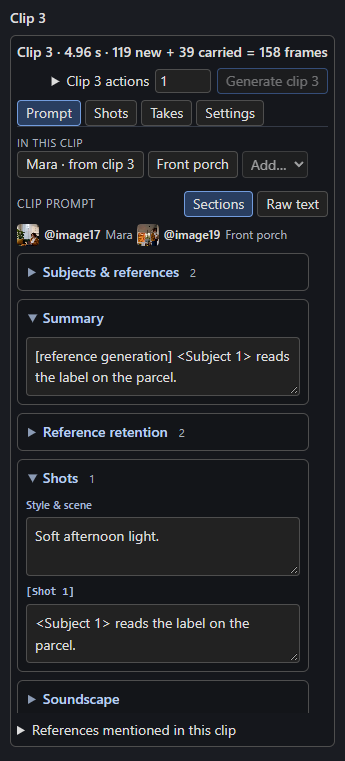

# Cast and the Story bible

The **Story bible** is the Timeline's list of **characters, places and props**. Each entity has a name, a kind, its pictures, a description and its **looks** over time; each clip records which of its subjects is which entity. It lives in the Timeline, so saving the workflow, Export and Import carry it. **Rendering never reads it**: the clip prompts are still what render. After rendering, the Story's Vision model can [check](../continuity/check.md) each clip against it.

## Build a bible

Open the Studio's **Cast** page. Until a bible exists it offers **Build bible**, which links each clip's subjects to entities without changing any prompt.

Build bible reads every `<Subject N> is …` line in the clips' `subject_definitions`, plus the linked Story's saved plan when that Story wrote this Timeline. It works without a plan and writes no prompt. Its summary reads like *3 entities from 4 boxes. Mara has 2 looks. Nothing that renders changed.*, followed by any line it left unlinked and why.

!!! note "Prompt format"
    Build bible links `<Subject N> is …` lines such as `<Subject 1> is a woman with short curly auburn hair in @image17.`, where the subject names a picture. A line the bible can't reproduce exactly is listed as *unlinked* with a reason instead of being rewritten. For example, the bundled memory demo's subject lines point at earlier video moments (`<Video 1>`) rather than pictures, so Build bible lists them as unlinked and changes nothing.

## The Cast page

**Reference images** opens first. Filter Characters, Locations or Objects, or search by name; filtering does not change which categories are generated. Select a reference in the thumbnail list to edit one description and review its images. On a phone, **Back to references** returns to the list.

**Batch options** selects categories for **Generate missing**; **Include in batch** controls one asset. Generator settings and stop-after-current remain beside the batch action. **Add object** opens a short object form. Seed and dimensions live under Advanced.

An uploaded reference is ready immediately. A generated candidate needs an explicit **Use as reference** approval; an out-of-date candidate cannot silently replace the approved image. Prompt edits survive catalog refreshes, and generation or upload errors leave the editor available for recovery.

One row per entity shows its first picture, name and kind, the clips it appears in and its number of looks (plus, in amber, how many of its clips differ). Click a row to open the entity.

| Field | Does |
| --- | --- |
| **Name**, **Kind** | Character, place or prop. |
| **Pictures** | **Replace…** swaps a picture for another connected image or visual RefMod in the entity's wording and its clips' lines. **Upload…** adds a new one in the same edit. |
| **Clips** | One cell per clip, coloured by the look in force there. Amber = the clip differs; empty = the entity isn't linked. Click a cell to select that clip. |
| **Description** | Edit and press **Apply** (**Esc** cancels). It writes the new wording into every clip where the description is in force. |
| **Voice** | How the entity sounds, used by the writer. |
| **Voice clip** | See below. |
| **Looks** | A look applies from its clip until the next one. Each has its starting clip, its wording with **Apply**, **Delete**, and a **Picture…**. **+ Look from clip N** starts a look at the selected clip. |
| **Pinned moments** | See [Remembering the cast](#remember-the-cast). |
| **Merge into…**, **Delete entity** | Merge links the entity's subjects to another entity; delete unlinks them and changes no prompt. |

The **Style** row above the list holds the look every clip shares. After each change a one-line note says what happened, for example *Updated 6 boxes; box 6 differs and was left alone.*

### A look's picture

A look can have its own picture. When a character changes outfit, choose the picture showing the new outfit with the look's **Picture…**; **None** removes it. Every clip where that look is in force shows the picture instead of the entity's, and wording that named the old picture names the new one. A later look without a picture, such as *soaked*, keeps the picture in force and says the change in words.

### Clips that differ

A linked subject **differs** when its line isn't the one the bible gives it, for example after you edit the Prompt tab or Write rewrites the clip. Bible edits leave differing lines alone. The entity lists each with three choices: **Use the bible's wording**, **Make it a look from clip N**, or **Someone else…** (link to another entity or a new one).

### Chips on the Clip panel

[{ align=right width=240 }](../assets/screens/box-chips.png)

Above the Clip panel's tabs, chips list the selected clip's subjects: *Mara · from clip 3* names the entity and the look in force; an amber chip differs; a grey *Subject 3 · not linked* chip offers **Link…**. Click a chip to open its entity. With a bible the chips show the clip's **schedule**: who is in it and where, with × to remove, **Add…** and **Place**.

## Writing with the bible

[Write](writer.md) uses the bible when the Timeline has one, and when it plans an empty Timeline it starts one. A Timeline with clips and no bible writes as before; build its bible first to write with it.

- **Planning**: the planner reads the bible and never changes its entities, though it may add characters, places and props the story needs, with a kind, description and voice. Each clip gets a schedule and a join. A schedule or join you saved is kept.
- **Joins**: with a bible, the **Join** selector replaces the Cut and New scene switches (Continue, Transition, Cut, New scene, with an optional note).
- **The compiled prompt**: the writer names entities by id, and **code** writes the prompt from the wording in force at that clip, so definitions, style and voices come from the bible. The writer's reply is kept as the clip's **source**.
- **Priority**: the Guide, then the idea, the bible, the clip's plan, the shot rules and last the general H3 guidance. A [template](templates.md) ranks after everything you wrote.
- **Looks**: when the writer changes how an entity looks, the change becomes a look from that clip, with a note.

### Cast edits after Write

While a clip's prompt is still what its source compiles to, every Cast edit compiles the whole clip again; shots, dialogue, sound and timing stay the writer's. A clip you edited by hand gets only a line-by-line update, and its chips start with *Edited by hand* and **Recompile from source**, which drops your edits.

A new wording can leave shot text that still describes the old look (a dry coat that is now soaked). The Cast page then offers **Update prose with the writer**, which sends only the affected clips and patches only the text the new wording contradicts. It runs like Story feedback, and either every patch lands or none does.

## Voice clips

A character can have a **voice clip**: a recording H3 hears in clips where that character speaks, so the voice stays the same from clip to clip. On the Cast page open the character and press **Upload…** in its **Voice clip** row (or drop an audio file on the row). The file goes to `input/h3_audio`, and the Timeline keeps it on a slot of its own from `@audio4` up, so it doesn't use one of the three standard audio slots except in clips where it is sent.

- The row shows the file and its length with **Play**, **Upload…** and **Remove**. H3 hears the whole file each time, so a short sample costs less memory and time (a note appears above 30 s).
- A clip written from the bible sends the clip when the character has a line in it, voiceover included. Unnamed speakers never get a clip. Places and props have none.
- The voices take what is left of H3's three audios after the lane clips and mentioned audios; one that doesn't fit is left out with a note.
- Rendering such a clip needs an **audio VAE** connected to the Timeline, or it stops with *connect an audio VAE to Timeline*.
- A voice clip **never plays in the full video**.

## Remember the cast

With a bible, a clip's **Visual memory** can be **Cast**: it shows H3 earlier moments of what its pictures don't show (each scheduled character as they look now, and the place).

**Pins** choose the moment: play a clip's take in the Studio, pause where a character or place shows well, and press **Pin moment for…** beside **Open in new tab** and **Download**. Buttons for the clip's scheduled characters and place appear; choose one and the Cast page notes it, for example *Pinned clip 1 at 2.0 s for Mara.* Each entity lists its **Pinned moments**, newest first, with **Remove**. The button shows only on a clip's current take. A pin is a Cast edit, so Ctrl+Z undoes it.

A Cast clip remembers, in order and up to three moments in total: each scheduled character that no picture in the clip shows as they look now (the latest pin since their current look began, otherwise the middle of their last shot in the first clip of that look), then the place (unless the clip continues the clip before at the same place). A moment is remembered once and only moments from the current look count, so a look change drops the older ones. A clip needs a render again when its moments change or a clip it remembers renders again.

## Undo

Each Cast change, **Build bible** included, is one step in the Studio's [editing history](../getting-started/studio-tour.md#undo-redo-and-history): it reverts the bible, the prompts and the links together. **Undo** (Ctrl+Z outside a field) goes back; **Redo** goes forward. A prose update or Story feedback can also be undone with the Story's **Undo**.

## Prepare references

The optional **Prepare references** section creates reviewable image candidates for characters, scheduled looks, locations and arbitrary objects with a native still generator. See [First and last frames](../build/frame-guides.md#optional-reusable-images-for-cast).

## Add an entry to a clip

In the selected clip's Prompt tab, choose Add from Cast under In this clip. It inserts the next unused Subject using the entry's look and pictures at this clip, links it to Cast, and updates the schedule as one undo step. Adding an already linked entry does not duplicate it. Place uses the same insertion for locations. Adding a picture can change the clip's H3 reference mode; missing, disabled or excessive references must be fixed first.

Remove from schedule leaves the prompt text in place. Subject text and its Cast link can be edited separately in Sections. Cast bindings belong to the main video when a clip has alternate videos; adding Cast opens that video's prompt.
